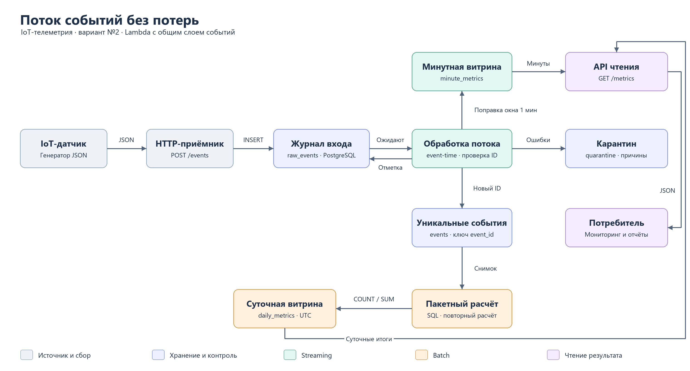

# Отчёт по практической №2

## 1. Вариант и задача

| Поле | Значение |
|---|---|
| ФИО (как в VK Education) | Дубовой Андрей Михайлович |
| Тема | Вариант №2 — Streaming vs Batch. Поток событий без потерь |
| Состав решения | Генератор IoT-телеметрии, HTTP-приёмник, потребитель Python, пакетный расчёт SQL, PostgreSQL и API чтения двух витрин |
| Данные, объем | Синтетические показания одного датчика за 23–24 ноября 2026 года по UTC. Из 23 запросов `POST /events` по полному сценарию 21 записан в журнал |

Группа БИВТ-24-ПАУ-2.

Задача — показывать свежие `COUNT` и `SUM` по минутам и формировать точные итоги по суткам. Отчёт должен обновляться, если показание за прошлые сутки пришло позже.

## 2. Источники и способы сбора

| Источник | Тип (поток / batch / CDC / документы в md pdf или другой/ API) | Способ сбора |
|---|---|---|
| Синтетическая телеметрия датчика `sensor-01` | Поток / HTTP API | `app.py verify` отправляет JSON с `event_id`, `sensor_id`, `event_time` и `value` через `POST /events`. Фиксированный набор даёт повторяемый сценарий с дублями и задержками. Приёмник возвращает `202` после фиксации строки в `raw_events` |
| Таблица `events` в PostgreSQL | Batch / внутренний источник | SQL читает согласованный снимок уникальных событий. Пакетный расчёт может повторить агрегацию по всей истории, включая исправления прошлых суток |

## 3. Архитектура (draw.io безальтернативно)



[Редактируемая схема architecture.drawio](architecture.drawio)

**Lambda и Kappa.** Выбрана упрощённая Lambda с общим слоем уникальных событий. Потоковый обработчик инкрементально поддерживает минутные окна, а пакетный процесс отдельно пересчитывает суточную витрину из сохранённых событий. Суточная витрина служит источником отчёта, поэтому складывать её с минутными показателями не нужно. В Kappa историческую агрегацию можно было бы заново построить повторным чтением долговременного журнала тем же потоковым кодом. Для небольшого стенда SQL-пересчёт проще проверить и запустить отдельно. Цена выбранного подхода — два расчёта, для которых важно согласовать часовой пояс и правила отнесения к окнам.

**Event-time.** Минуты и календарные сутки UTC определяет `event_time` датчика. Время обработки показывает, когда запись стала доступна системе. Если бы агрегация использовала время обработки, запоздавшее утреннее показание ушло бы в минуту фактического прихода. В стенде дата до 1970 года или более чем на 5 минут в будущем означает ошибку данных. Обработчик помещает такую запись в карантин и продолжает читать очередь.

**Поздние события.** Водяной знак равен максимальному принятому `event_time` минус 120 секунд. Событие раньше текущего знака помечается как позднее. В стенде окна остаются доступными для корректировки, поэтому новое валидное событие обновляет свою минуту независимо от опоздания. При большом потоке можно держать короткий горизонт правок в оперативной витрине, направлять более поздние записи в отдельный поток коррекций и пересчитывать затронутые сутки. Сырые записи нужны в обоих случаях.

**Дубли и сбои.** Отправитель сохраняет ID при повторе доставки. Сырой журнал сохраняет каждую принятую попытку, таблица `events` имеет первичный ключ `event_id`. Точный повтор ничего не прибавляет. Другие данные с уже занятым ID сохраняются в карантине с причиной, первая валидная версия продолжает участвовать в расчёте. Фиксация уникального события, обновление минуты и отметка обработки входят в одну транзакцию. При сбое до её фиксации строка остаётся в очереди. При масштабировании можно вынести журнал в Kafka, подтверждать смещение после фиксации результата и по-прежнему использовать устойчивый ключ в приёмнике.

**Движок и хранение.** Python читает журнал порциями по одной записи с паузой при пустой очереди. PostgreSQL хранит журнал, состояние водяного знака, карантин и обе витрины в именованном томе. Для учебного потока этого достаточно. При росте нагрузки Flink или Spark Structured Streaming позволили бы распределить обработку, а полное сканирование событий можно заменить перерасчётом затронутых дат.

## 4. Docker — что поднялось (честно)

| Блок | Статус ( реализовано / нет) |
|---|---|
| PostgreSQL `postgres` | Реализовано, контейнер `healthy`. Созданы журнал, таблица событий, карантин и витрины |
| HTTP-приёмник и API чтения `ingest` | Реализовано, контейнер `healthy`. Проверены запросы `POST /events` и `GET /metrics` |
| Потоковая обработка `stream` | Реализовано, контейнер запущен. Проверены порядок, дубли, карантин и повторная обработка после сбоя |
| Пакетный пересчёт `batch` | Реализовано, контейнер запущен. Проверены суточные итоги и повторный расчёт |
| Генератор датчика `demo` | Реализовано, запущен как одноразовый контейнер через `docker compose run --rm --build demo` |
| Потребитель | Реализовано чтение витрин через JSON API. Отдельный графический интерфейс мониторинга не реализован |

Проверка проведена 26 ноября 2026 года на Windows с Docker Engine 29.4.3 и Compose v5.1.3. Прогон после ревью выполнен на чистом томе под именем проекта `vk-p2-dubovoy-check` с портом `18083`. По умолчанию проект использует порт `18082`.

```powershell
$env:COMPOSE_PROJECT_NAME = 'vk-p2-dubovoy-check'
$env:VK_P2_PORT = '18083'
docker compose config --quiet
docker compose up -d --build --wait
./verify.ps1
docker ps --filter label=com.docker.compose.project=vk-p2-dubovoy-check
docker compose ps
```

Сценарий `verify.ps1` запускается на пустом томе, отправляет тестовые события, проверяет обе витрины и имитирует падение обработчика до `COMMIT` с кодом 77. Пакетный сервис пересчитывает всю историю с паузой 10 секунд, чтобы в учебном стенде не ждать конца суток. При отправке позднего события тест сначала ждёт автоматического изменения суточной витрины через `GET /metrics`. Ручной повторный пересчёт проверяется отдельно.

| Проверка | Фактический результат |
|---|---|
| Некорректное тело запроса | `NaN` получил HTTP `400`, строка с экранированным NUL получила `422`. Обе попытки отклонены до записи в журнал |
| Исходный набор и граничная дата | Из 10 записей журнала получилось 6 уникальных событий с суммой 210, из них 2 поздних. В карантине 3 записи: дата первого года, ошибка структуры и конфликт ID. Очередь обработана полностью |
| Повтор исходного набора | В журнале 19 поступлений. В обеих витринах сохранились 6 событий и сумма 210. В карантине 5 записей с учётом повторных ошибок |
| Автоматическая поздняя корректировка и повтор batch | В API итог за 23 ноября вырос с 1 события и суммы 50 до 2 событий и суммы 120. По всем суткам получилось 7 событий и сумма 280. Ручной повтор пересчёта сохранил эти значения |
| Прерывание до `COMMIT` | После отката 1 запись ожидала обработки, а число уникальных событий осталось равным 7 |
| Восстановление | После запуска `stream` ожидание обнулилось. Из 21 записи журнала получено 8 уникальных событий с суммой 360, из них 3 поздних. За 23 ноября — 2 события с суммой 120, за 24 ноября — 6 событий с суммой 240 |

Приложены [вывод `docker ps`](evidence/docker-ps.log), [состояние Compose](evidence/compose-ps.log), [лог запуска](evidence/startup.log), [лог сквозной проверки](evidence/verification.log) и [финальный ответ API](evidence/metrics.json).

## 5. Описание

| Шаг | Для чего | Результат |
|---|---|---|
| 1. Сгенерировать и отправить телеметрию | Воспроизвести события вразнобой, дубль и запись с задержкой | Приёмник получает JSON, включая повторы и записи с ошибкой структуры |
| 2. Зафиксировать входящие данные | Пережить остановку потребителя и сохранить вход для разбора | Каждая принятая попытка получает `arrival_id`. Ошибка после отправки допускает повтор с прежним `event_id` |
| 3. Проверить и применить событие | Распознать повтор, конфликт и опоздание | Валидное новое событие добавляется в `events` и обновляет минутную витрину. Некорректные записи видны в `quarantine` |
| 4. Пересчитать сутки | Получить точные `COUNT` и `SUM` по дате UTC и датчику на момент снимка | Новый пакет атомарно заменяет `daily_metrics`, поэтому период можно пересчитать сколько угодно раз |
| 5. Выдать результат | Раздельно показать оперативные и отчётные показатели | `GET /metrics` выводит минутные и суточные итоги, число ожидающих строк и водяной знак |

## 6. Выводы

Минутная витрина показала изменения сразу после обработки, а суточная смогла исправить итог за прошедшую дату. Повтор доставки менял размер журнала, но значения витрин оставались прежними. Опыт со сбоем показал, зачем менять витрину и отмечать запись обработанной в одной транзакции: после отката обработчик смог вернуться к тому же входу и учесть его один раз.

Проверка покрывает единичный сбой потребителя и тестовый объём. Сохранность подтверждённых входов зависит от тома PostgreSQL. Для работы при потере диска потребовались бы резервное копирование или репликация, а для гарантии до получения `202` — очередь повторов на стороне датчика.

### Мой любимый десерт

Мой любимый десерт — брауни. Не знаю, является ли этот пункт проверкой внимательности, но включаю его по шаблону.
